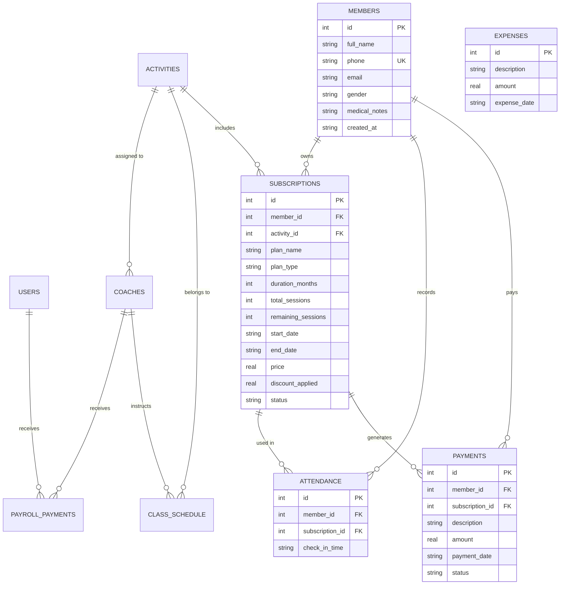

# FORGE FITNESS & MARTIAL ARTS MANAGEMENT SYSTEM
## Comprehensive Project Documentation & Architecture Guide

---

## 1. Executive Summary & Purpose

**Forge Fitness Management System** is a professional desktop application engineered in **Java 25** and **JavaFX 21** backed by an embedded **SQLite** database. It is designed to run the daily operations of modern fitness centers, gyms, and martial arts academies. 

The software eliminates operational friction by providing:
- Automated membership tracking and subscription lifecycles.
- Fast attendance check-in using physical USB QR-code scanners.
- Comprehensive financial auditing, payments, expenses, and payroll.
- Dynamic weekly training class scheduling with capacity limits.
- Full bilingual support (**English** and **Arabic with native Right-To-Left UI**).
- A **Pro-tier visual design system** with Dark & Light modes and customizable accent themes.
- Safe offline operation, data export to Excel (CSV with UTF-8 BOM), and 1-click database backups.

---

## 2. Clean Architecture & Code Organization

The codebase adheres strictly to **Clean Architecture** principles, maintaining a high degree of decoupling, testability, and single responsibility.

```
com.gym.system
├── Launcher.java                          // Application entry point for fat-JAR compatibility
├── GymApplication.java                    // Composition Root & Lifecycle Manager (~190 lines)
│
├── dao/                                   // Data Access Layer (Persistence)
│   ├── DatabaseConnection.java            // SQLite connection, pool timeouts & schema migrations
│   ├── GymDataAccess.java                 // Primary Repository Interface
│   ├── GymRepository.java                 // Concrete SQL Repository Implementation
│   ├── ClubRepository.java                // Coaches, Activities, Schedules, Payroll queries
│   ├── UserRepository.java                // PBKDF2 Hashing, authentication, user queries
│   ├── MemberDAO.java                     // Dedicated Member CRUD contract
│   ├── SubscriptionDAO.java               // Dedicated Subscription CRUD contract
│   └── UserDAO.java                       // Dedicated User authentication contract
│
├── service/                               // Business Logic Layer (Services)
│   ├── MemberService.java                 // Member business rules & queries
│   ├── SubscriptionService.java           // Subscription lifecycles, freeze, payments
│   ├── AttendanceService.java             // Verification, session consumption, QR check-ins
│   ├── ScheduleService.java               // Class scheduling & capacity
│   ├── CoachService.java                  // Coach management & PT assignment
│   ├── ActivityService.java               // Sports & training programs
│   ├── FinanceService.java                // Expenses & payment audits
│   ├── PayrollService.java                // Monthly salary distributions
│   └── TeamService.java                   // Staff account security & password updates
│
├── controller/                            // UI Controllers & Page Builders
│   ├── DashboardController.java           // FXML Controller for shell layout & topbar
│   ├── LoginController.java               // FXML Controller for sign-in screen
│   ├── PrintController.java               // Paper printing (Cards, Invoices, Reports)
│   ├── FormDialog.java                    // Generic modal dialog builder with validation
│   │
│   ├── page/                              // Modular Self-Contained Views
│   │   ├── DashboardPage.java             // Metric summary, charts, quick actions
│   │   ├── MembersPage.java               // Member table, search, filters, card printing
│   │   ├── SubscriptionsPage.java         // Plan renewals, freeze/unfreeze, invoice
│   │   ├── AttendancePage.java            // Live USB QR scanner & manual check-in
│   │   ├── SchedulePage.java              // Weekly timetable & coach assignments
│   │   ├── CoachesPage.java               // Staff coaches & personal trainers
│   │   ├── ActivitiesPage.java            // Sport types & demand reports
│   │   ├── FinancePage.java               // Revenue, expenses & payment history
│   │   ├── PayrollPage.java               // Monthly staff & coach salary disbursement
│   │   └── TeamPage.java                  // Administrative user accounts
│   │
│   ├── form/                              // Strongly-Typed Modal Dialog Forms
│   │   ├── MemberForm.java                // Create & update member profile
│   │   ├── SubscriptionForm.java          // Plan creation (time or sessions)
│   │   ├── CoachForm.java                 // Coach profile & salary
│   │   ├── ActivityForm.java              // Bilingual activity setup
│   │   ├── ScheduledClassForm.java        // Timetable slot assignment
│   │   ├── UserForm.java                  // Staff registration & password changes
│   │   ├── ExpenseForm.java               // Club expense records
│   │   └── CheckInForm.java               // Manual member selector
│   │
│   └── helper/                            // Shared UI Utilities & Adapters
│       ├── PageContext.java               // Unified context record (state, translations, alerts)
│       ├── TableFactory.java              // Standardized responsive TableView builder
│       ├── MetricCardFactory.java         // Polished dashboard KPI card factory
│       ├── NavigationHelper.java          // Role-based navigation generation
│       ├── AppearanceHelper.java          // Dynamic theming, colors, and RTL utilities
│       ├── DataExportHelper.java          // Excel/CSV exports with UTF-8 BOM
│       └── DatabaseBackupHelper.java      // 1-Click SQLite database backup/restore
│
├── model/                                 // Domain Entities (POJOs / Records)
│   ├── Member.java                        // Member entity with field normalization
│   ├── Subscription.java                  // Subscription entity (TIME_BASED vs. SESSION_BASED)
│   ├── User.java, Admin.java, Receptionist.java // User hierarchy
│   ├── Coach.java                         // Trainer record
│   ├── Activity.java                      // Sport/activity record
│   └── ScheduledClass.java                // Timetable record
│
└── util/                                  // Technical Utilities
    ├── AlertUtils.java                    // Theme-aware JavaFX dialogs
    ├── AppearanceSettings.java            // Preferences persistence (dark mode, accent)
    ├── LanguageManager.java               // I18N Resource bundle manager (en / ar)
    ├── PasswordService.java               // PBKDF2 with SHA-256 + Salt cryptography
    ├── PrintService.java                  // JavaFX PrinterJob wrapper
    ├── QrCodeService.java                 // ZXing QR barcode generator
    └── SessionManager.java                // Current authenticated user session state
```

---

## 3. Core Feature Walkthrough

### 3.1. Authentication & Role-Based Access Control (RBAC)
- **Roles:** `ADMIN` (Full administrative power) and `RECEPTIONIST` (Operations-only).
- **Security:** Passwords are never stored in plaintext; they are hashed using **PBKDF2 with HMAC-SHA256** and unique cryptographic salts.
- **Enforcement:**
  - Navigation items for sensitive pages (`Finance`, `Payroll`, `Staff accounts`) are hidden from Receptionists.
  - Hardened access control prevents direct or programmatic access to restricted pages if a receptionist is logged in.

### 3.2. Dashboard & Executive Overview
- Displays 4 key live KPIs: **Total Members**, **Active Members**, **Today's Check-ins**, and **Monthly Revenue**.
- **Financial Balance Banner:** Compares monthly revenue against operating expenses to compute immediate Net Profit or Loss.
- **Quick Action Bar:** 1-Click buttons to register a member, print a comprehensive executive report, or create a database backup.
- **Activity Demand Matrix:** Overview of popular activities, registered members, check-ins, and generated revenue.

### 3.3. Member Management & Profiles
- Register members with full name, unique phone number, email, gender, and medical notes.
- Real-time search across all member fields simultaneously.
- **Status Filter:** Instantly filter between *All*, *Active Members*, or *Expired Members*.
- **Member QR Card Printing:** Generates a printable ID card featuring member details and a high-resolution QR barcode (`MEM-0001`).
- **CSV Data Export:** Export the complete member directory to a UTF-8 CSV file compatible with Excel.

### 3.4. Subscription Engine & Flexible Billing
- **Two Plan Types:**
  1. `TIME_BASED`: Configured with start date, duration (months), and calculated end date.
  2. `SESSION_BASED`: Configured with total allowed session count (e.g., 10 or 20 visits).
- **Membership Lifecycle:**
  - `ACTIVE`: Member can check in.
  - `FROZEN`: Temporarily pauses access without deleting the subscription.
  - `EXPIRED`: Time period elapsed or all sessions consumed.
- **Payment Collection Workflow:**
  - New subscriptions are created with `PENDING` payment status.
  - Front-desk staff confirm offline payments when funds are physically received, moving the status to `PAID`.
  - Printable official invoices (`INV-xxx`) with QR barcode verification.

### 3.5. Attendance & USB Hardware QR Scanning
- **Hardware Integration:** Compatible with any standard USB HID keyboard-emulation QR scanner.
- **Automated Verification:**
  - Scans barcode `MEM-xxxx`, checks active status, date eligibility, or session balance.
  - Automatically deducts 1 session if session-based; marks membership expired when remaining sessions hit 0.
  - **Duplicate Check-in Protection:** Rejects duplicate scans for the same member on the same calendar day with a clear, friendly warning.
  - **Color-Coded Feedback:** Green alert badge for successful entry with member name and remaining quota; red alert badge for expired memberships or invalid codes.
- **Manual Check-in:** Front-desk staff can manually check in members by name.

### 3.6. Class Scheduling & Timetable
- Schedule weekly recurring fitness or martial arts classes (Monday through Sunday).
- Link classes to specific sports/activities and assign dedicated coaches.
- Define start time, end time, and room capacity limits.

### 3.7. Coaches & Personal Trainers
- Maintain coach profiles, phone contacts, base monthly salaries, and activity specialties.
- Flag whether a coach operates as a 1-on-1 Personal Trainer (`PT`).

### 3.8. Finance, Expenses & Payroll
- **Expense Logging:** Track utility bills, equipment purchases, maintenance, and supplies.
- **Monthly Payroll:**
  - Generates payroll lists for both staff and coaches for any selected month (`YYYY-MM`).
  - Idempotent salary disbursement: prevents double-paying the same employee in the same month.
  - Payouts are automatically counted toward the club's monthly expense total.
- **Financial Report Printing:** Generates formal accounting reports detailing collections, disbursements, and net balance.

### 3.9. Database Backup & Disaster Recovery
- **1-Click Backup:** Copies the live SQLite database (`gym_system.db`) to any user-selected external folder, USB drive, or cloud directory.
- **Database Restore:** Easily restore the entire system from a previous `.db` snapshot.

---

## 4. Database Architecture & Schema

The system stores all data in SQLite at `%USERPROFILE%/.gym-system/gym_system.db`.



### Critical Database Integrity Rules:
1. `one_checkin_per_member_day`: A unique index on `attendance(member_id, date(check_in_time))` prevents multiple entries per member on the same calendar day.
2. `UNIQUE(employee_type, employee_id, pay_month)`: Prevents duplicate salary disbursements in the same month.
3. `PRAGMA foreign_keys = ON`: Enforces relational integrity across all tables.

---

## 5. UI & Styling System (Pro Design System)

The UI stylesheet (`src/main/resources/com/gym/system/views/css/style.css`) is structured with modern design principles:
- **Light Theme:** `#F8FAFC` background with crisp white surfaces, soft drop shadows, and slate typography.
- **Dark Theme:** `#0B0F19` obsidian background with `#131B2E` cards, subtle borders, and low-contrast dividers.
- **Dynamic Accent Color:** Users can click the color picker in the top-bar to switch the accent color to Orange, Emerald, Cyan, Violet, or Blue on the fly.
- **Bilingual Layout:** Switching between English and Arabic automatically updates the `NodeOrientation` between Left-To-Right and Right-To-Left (`RTL`).

---

## 6. How to Build, Test, and Run

### Prerequisites
- **Java Development Kit:** JDK 21 or JDK 25 installed.
- **Operating System:** Windows, macOS, or Linux.

### Commands

1. **Run Automated Unit Tests:**
   ```powershell
   $env:JAVA_HOME = "C:\Program Files\Java\jdk-25"
   .\mvnw.cmd test
   ```
   *Result:* 8 tests run, 0 failures, 0 errors.

2. **Package Application JAR:**
   ```powershell
   .\mvnw.cmd package -DskipTests
   ```
   *Produces:* `target/gym-system-1.0-SNAPSHOT.jar`

3. **Launch the Application:**
   ```powershell
   .\mvnw.cmd javafx:run
   ```
   *Or directly using Java:*
   ```powershell
   & "C:\Program Files\Java\jdk-25\bin\java.exe" -jar target/gym-system-1.0-SNAPSHOT.jar
   ```

---

## 7. Default System Credentials

When starting on a clean database, the system automatically initializes default user accounts:

| Username | Default Password | Role | Permissions |
| :--- | :--- | :--- | :--- |
| **`admin`** | `admin123` | **ADMIN** | Full system control: Operations, Finance, Payroll, Staff accounts, and Database backups. |
| **`reception`** | `reception123` | **RECEPTIONIST** | Operations: Member registration, Subscriptions, Check-in, Class schedules, and Printing. |

---
*Created and maintained as part of the Forge Fitness Clean-Code Architecture standard.*
