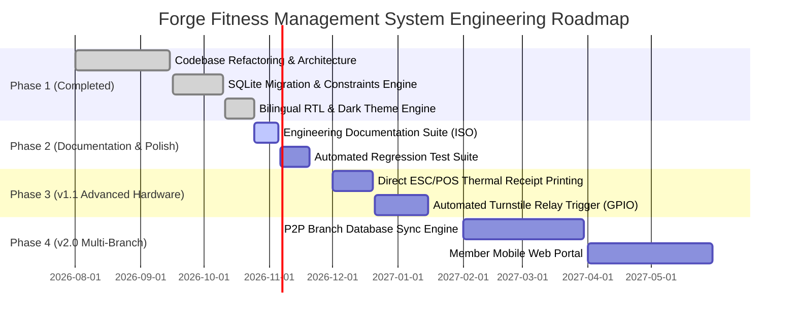

# 06. Scope, MVP & Engineering Roadmap

> **Document ID:** DOC-PROD-006  
> **Standard:** ISO/IEC/IEEE 29148  
> **Target System:** Forge Fitness Management System  
> **Version:** 1.0.0

---

## 1. MVP (Minimum Viable Product) Definition

The primary objective of the MVP is to replace all paper registries and Excel sheets in a single gym branch with a zero-failure, offline-ready desktop solution.

### 1.1 MVP Mandatory Capabilities (Release 1.0.0 — COMPLETED)
- [x] Local SQLite embedded database initialization with ACID compliance.
- [x] Staff authentication via PBKDF2 cryptography with `ADMIN` and `RECEPTIONIST` roles.
- [x] Full Member CRUD with phone number uniqueness and photo/medical notes.
- [x] Time-based and Session-based subscription plans with discounts.
- [x] Hardware USB QR Code scanner attendance with instant audible/visual feedback.
- [x] 1-check-in per member per day database constraint.
- [x] Revenue, Expense, and Monthly Payroll tracking with Net Profit calculation.
- [x] Dynamic Arabic (RTL) and English (LTR) language switching.
- [x] Dark Mode and Light Mode with custom accent palettes.
- [x] 1-Click Database Backup and Restore.
- [x] Excel/CSV export with UTF-8 BOM encoding.

---

## 2. Release Roadmap & Milestones

---

## 3. Detailed Phase Breakdown

### Phase 1: MVP Core Launch (Current Production Baseline - v1.0.0)
- Single-terminal reception desk deployment.
- High speed QR attendance via USB keyboard emulation.
- Fully localized in Arabic and English.
- Complete financial logging (Revenue, Expense, Payroll).

### Phase 2: Quality Assurance & Hardware Drivers (v1.1.0)
- **Thermal Receipt Printer Support:** Direct raw printing to standard 80mm ESC/POS receipt printers for instant payment receipts.
- **Hardware Turnstile Trigger:** Integration with RS-232/USB relay modules to automatically unlock physical turnstiles upon valid check-in.
- **Automated Expired Plan Batch Cleanup:** Scheduled daemon to automatically mark past-date plans as `EXPIRED`.

### Phase 3: Enterprise & Multi-Branch Expansion (v2.0.0)
- **Multi-Branch Data Sync:** Encrypted peer-to-peer or server-assisted synchronization between branch databases.
- **SMS & WhatsApp Notifications:** Automated reminder messages sent to members 3 days prior to subscription expiration.
- **Member Self-Service Kiosk Mode:** Touchscreen-optimized interface allowing members to scan their cards and view remaining sessions or timetable changes.

---

## 4. Explicitly Out-of-Scope (Non-Goals)
- Implementing a public web e-commerce storefront.
- Integrating third-party cloud analytics or tracking pixels (strict offline privacy guarantee).
- Cloud subscription billing for the software itself (it remains an owned, perpetually licensed standalone desktop package).
