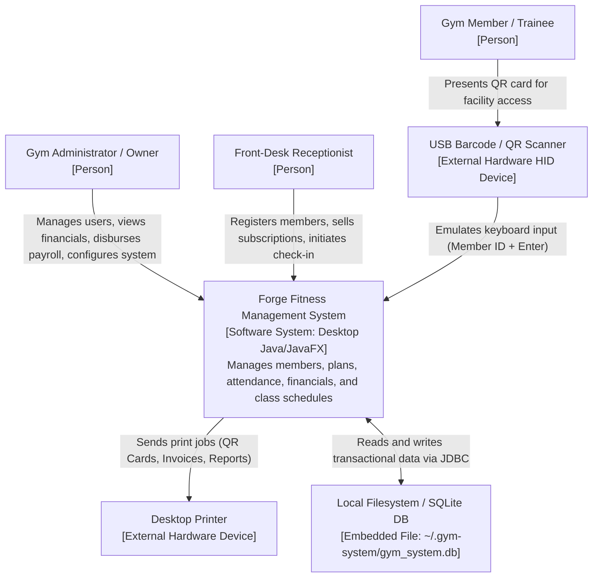
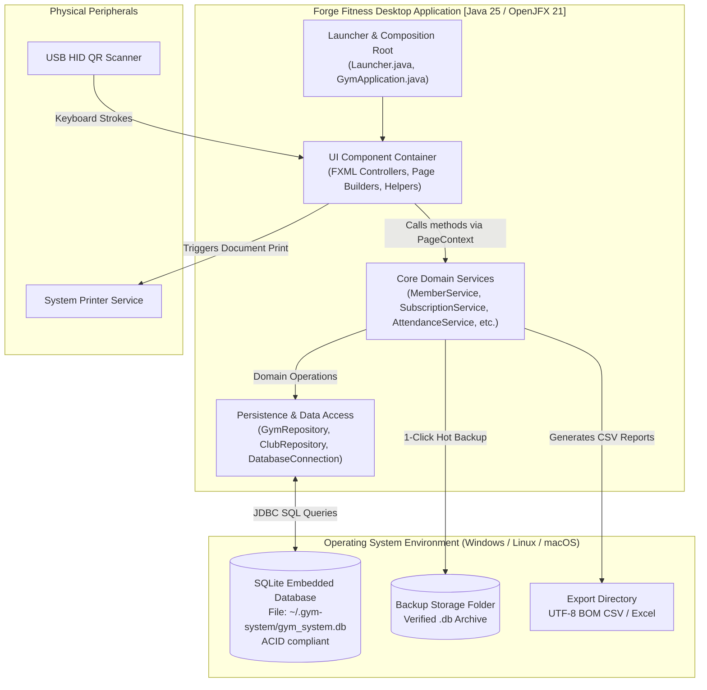
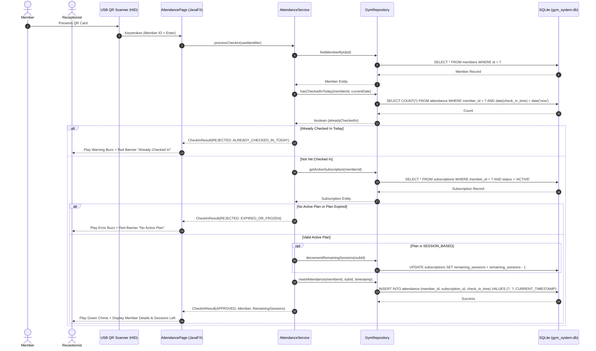
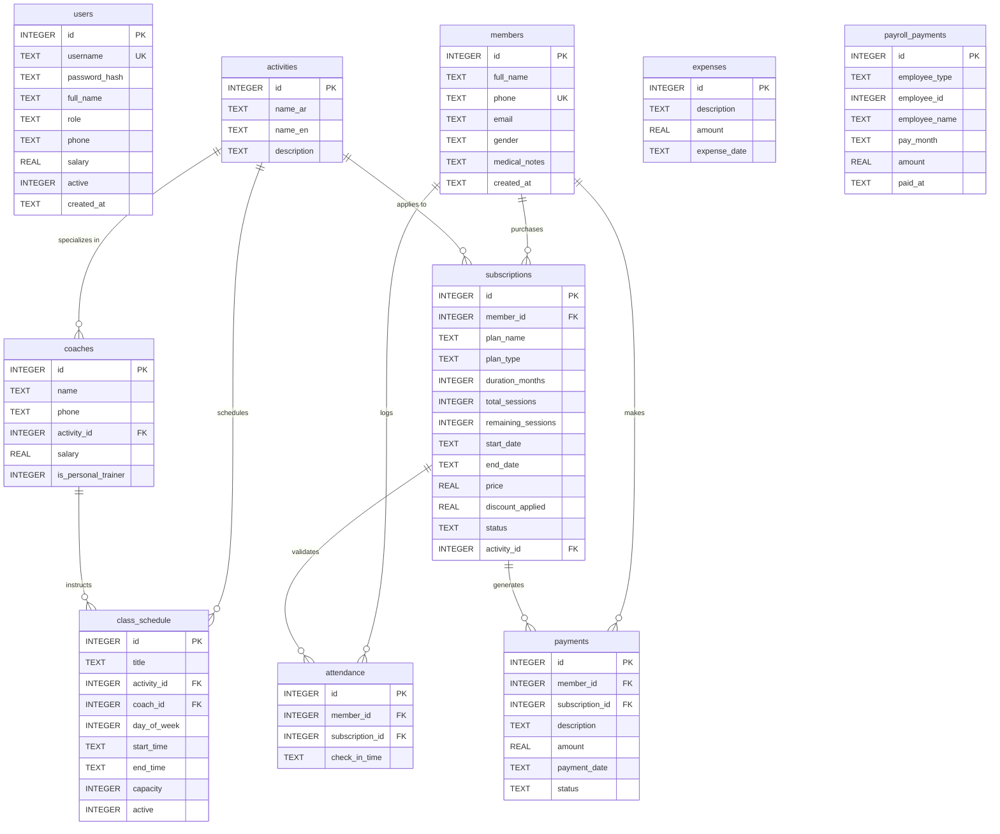
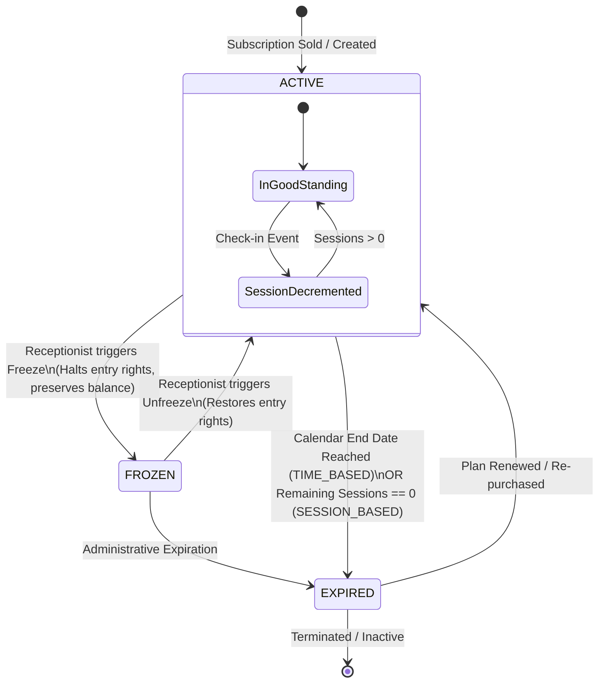

# 03. Architecture & Engineering Diagrams Visual Guide

> **Standard Compliance:** C4 Model & OMG UML 2.5  
> **Source Directory:** `docs/03-diagrams/`  
> **Target System:** Forge Fitness & Martial Arts Management System  
> **Status:** All 15 Diagrams Verified & Aligned with Codebase

---

## Table of Diagrams

| # | Diagram Name | Category | File Reference | Primary Focus |
| :- | :--- | :--- | :--- | :--- |
| **01** | System Context Diagram | C4 Level 1 | `01-system-context.mmd` | System boundaries, users, and external peripherals |
| **02** | Container Diagram | C4 Level 2 | `02-container.mmd` | Desktop container, SQLite, filesystem, and OS |
| **03** | Component Diagram | C4 Level 3 | `03-component.mmd` | Internal pages, services, DAOs, and interactions |
| **04** | Package Diagram | Architecture | `04-package.mmd` | Java package modularity and dependencies |
| **05** | UML Use Case Diagram | Requirements | `05-use-case.mmd` | Admin vs Receptionist functional interactions |
| **06** | Subscription Activity Diagram | UML Behavioral | `06-subscription-activity.mmd` | Workflow of plan selection, discount, and payment |
| **07** | Attendance Sequence Diagram | UML Behavioral | `07-attendance-sequence.mmd` | Message flow for rapid QR check-in & verification |
| **08** | Subscription State Machine | UML Behavioral | `08-subscription-state-machine.mmd` | Status transitions: Active, Frozen, Expired |
| **09** | Entity-Relationship Diagram | Data Model | `09-erd.mmd` | Complete SQLite tables, columns, keys, and cardinality |
| **10** | Domain & Service Class Diagram | UML Structural | `10-class-diagram.mmd` | OO hierarchy: User, Member, Subscription, Services |
| **11** | Runtime Object Diagram | UML Structural | `11-object-diagram.mmd` | Memory instance snapshot during a check-in event |
| **12** | Physical Deployment Diagram | Operations | `12-deployment.mmd` | Physical front-desk PC, USB ports, and peripherals |
| **13** | Backup & Recovery Flowchart | Operations | `13-backup-recovery-flow.mmd` | Flowchart for verified hot backups and restores |
| **14** | Build & Release Pipeline | DevOps / CI | `14-build-pipeline.mmd` | Maven compile, JUnit 5 test, and JPackage installer |
| **15** | Dependency Diagram | Configuration | `15-dependency-diagram.mmd` | External libraries (OpenJFX, SQLite JDBC, ZXing) |

---

## 1. System Context Diagram (C4 Level 1)

---

## 2. Container Diagram (C4 Level 2)

---

## 3. Attendance Sequence Diagram (UML Sequence)

---

## 4. Entity-Relationship Diagram (ERD)

---

## 5. Subscription Lifecycle State Machine

